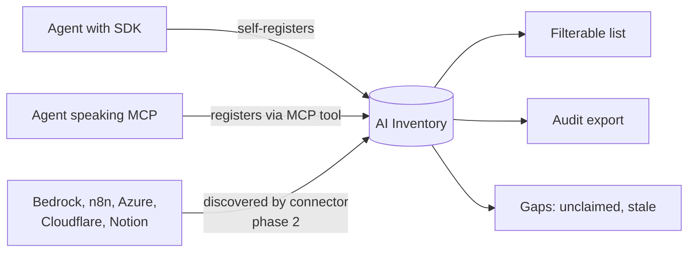
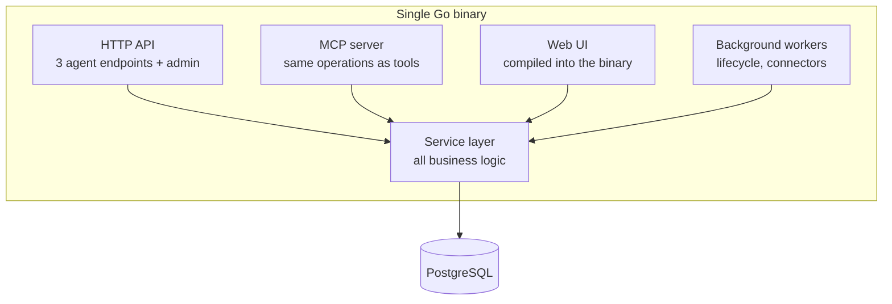

# AI Inventory — System Specification

**Audience:** Product managers, service owners, and anyone evaluating whether to run this.
**Status:** Draft — phase 1 in development
**Companion documents:** [FUNCTIONAL.md](FUNCTIONAL.md) (user stories) · [design doc](docs/plans/2026-08-15-ai-inventory-design.md) (engineering detail)

---

## 1. What this is

AI Inventory is a single pane for every AI agent operating inside a business.

Most organisations passed the point of knowing what agents they run somewhere around the second quarter someone shipped one without telling anyone. The agents are real, they touch production data, they cost money, and there is no list. When an auditor, a regulator, or a board member asks "what AI is running in this company and who is accountable for it," the honest answer today is usually a spreadsheet that was accurate last month.

AI Inventory answers five questions for every agent:

| Question | Example |
|---|---|
| **What does it do?** | Triages accounts-payable invoices |
| **Who owns it?** | Finance Platform team |
| **What is it built on?** | LangGraph 0.4, Claude Sonnet, commit `a3f19c2` |
| **Where does it run?** | AWS Lambda, `us-east-1`, account `4471…` |
| **What does it touch?** | The billing database, the Notion API *(phase 2)* |

---

## 2. Who it is for

| Role | What they get |
|---|---|
| **CIO / Compliance** | A complete, exportable, defensible list — and an honest account of its gaps |
| **Service Owner** | Coverage. Knowing what exists, including what has never registered |
| **AI Engineer** | Three lines of code, then never thinking about it again |
| **Security** | Which agents run where, on what, reaching what *(phase 2)* |

---

## 3. How agents get into the inventory

Two paths, and both matter. Self-registration gives depth for agents whose teams cooperate. Discovery gives coverage for agents whose teams never will.

**Self-registration** is three lines in the agent, or zero lines if the agent already speaks MCP — in that case you add a server to its configuration and the model registers itself.

**Discovery** *(phase 2)* polls the platforms agents actually live on and reports what it finds. Anything that does not match a registered agent becomes an **unclaimed** record waiting for a human to assign an owner. This is how shadow AI surfaces.

---

## 4. Architecture at a glance

One binary, one database. That is the entire operational footprint.

Deployment is `docker run` or a file plus a database connection string. There is no separate frontend to deploy, no message queue, no cache tier, no search cluster.

Two properties are worth a product manager's attention because they are commitments, not implementation details:

**The HTTP API and the MCP server are not two implementations.** Both are thin adapters over one service layer, and one test suite runs against both. They cannot drift apart and tell agents different things.

**The self-hosted binary and the managed service are the same binary.** Different configuration, same code. There is no "open core" version that quietly lags.

---

## 5. Key capabilities

### Phase 1 — available at launch

**Self-registration in three lines.** One import, one call. Framework, version, hosting provider, region, repository, and commit are all auto-detected from the runtime. Everything detected can be overridden; nothing detected can fail loudly.

**Registration via MCP with no code at all.** Agents that already speak MCP register by configuration.

**Ownership that cannot be faked.** Administrators mint enrollment tokens scoped to one team and one environment. Agents inherit ownership from the token rather than claiming it in the payload. This is the difference between an inventory an auditor accepts and a list of self-reported assertions.

**Agents are counted once.** An agent that redeploys, restarts, or scales to twenty replicas remains one record with a replica count. Getting this wrong makes an inventory worthless within a week, so it is a core design constraint rather than a refinement.

**Full change history.** Every change to every agent is recorded with what changed, when, and by whom. "What did this look like in March" is answerable.

**Filterable list and audit export.** Filter on team, environment, platform, hosting provider, lifecycle state, and last-seen. Export any filtered view to CSV or JSON, stamped with the filter applied, the user, and the timestamp.

**A gaps view.** Unclaimed, stale, flagged, and incomplete records, each stating plainly why it is listed.

**Links to existing telemetry.** Agents report where their metrics already live — a Datadog dashboard, a Langfuse project, a CloudWatch log group. AI Inventory links out rather than duplicating an observability platform.

### Phase 2

Platform discovery connectors for AWS Bedrock Agents, Azure AI Foundry, Claude managed agents, n8n, Cloudflare, Notion, and LangGraph Platform. The connection graph — which agents touch which datastores, models, MCP servers, and third-party APIs, answerable in both directions.

### Phase 3

Cost and performance rollups reported on the heartbeat. Visibility into scheduled agents running in developer tooling, subject to answering the consent question first.

---

## 6. Two principles that shape the product

These explain behaviour that would otherwise look like bugs.

### Record and flag; never reject

A token used from an unexpected environment, a descriptor missing fields, a registration that looks duplicated — all get written and flagged rather than refused.

An inventory that rejects bad input develops blind spots, and blind spots are the exact failure the product exists to eliminate. If an agent is doing something odd, the worst outcome is that it stays invisible. This is also why nothing is ever deleted automatically: revoking a credential flags its agents, and an agent that stops reporting becomes `stale` rather than disappearing. **A stale record is a finding, not a cleanup task.**

### Never overstate what we know

Every export and summary states its unclaimed, stale, and flagged counts alongside the total. Auto-detected values are visually distinct from values an agent explicitly reported. Nothing inferred is ever presented as reported.

An inventory that overstates its completeness is worse to an auditor than a short one, because it converts a known gap into an unknown one.

---

## 7. Privacy boundary

**AI Inventory never collects prompts, completions, conversation content, end-user data, or model inputs and outputs.**

This is a hard product boundary, not a configuration setting. There is no code path in any SDK that can transmit user data. What the product collects is metadata about agents: what they are, who owns them, where they run.

This is what makes the product installable in a regulated environment without a six-month review, and it is a deliberate constraint on the roadmap — it rules out several otherwise attractive features.

---

## 8. What this deliberately is not

Saying no here is what keeps the product small enough to actually run.

| Not this | Why |
|---|---|
| An observability or APM platform | Datadog, Langfuse, and Braintrust do this well. We link to them. |
| An agent orchestrator or scheduler | We inventory agents, we do not run them. |
| A model evaluation tool | Different product, different buyer. |
| A runtime policy enforcer | We do not sit in the request path, so we cannot break production. |
| A general CMDB | AI agents only. The adjacent scope is unbounded. |
| A prompt or conversation archive | See §7. |

---

## 9. Security and access

Human access is OIDC against the organisation's existing identity provider, plus one bootstrap administrator for first run. **The product contains no password management** — every enterprise has an identity provider, and building user management adds risk without adding value.

| Role | Capability |
|---|---|
| Administrator | Full access, including tokens and ownership |
| Editor | Edit agent records |
| Viewer | Read |
| Auditor | Read and export, no mutation |

Enrollment tokens are scoped, expirable, and revocable, stored only as hashes and shown exactly once at creation. Every mutation is attributable to an actor in an append-only audit log. Multi-tenancy is enforced at the data layer from day one, even though a self-hosted install has a single organisation.

---

## 10. Licensing and business model

| Component | License | Why |
|---|---|---|
| Server, UI, connectors | **AGPL-3.0** | Anyone offering this as a hosted service must publish their modifications |
| Python and TypeScript SDKs, MCP client | **Apache-2.0** | No one should hesitate to embed a client in a production agent |

The self-hosted product is complete and not feature-limited. The intended commercial offering is managed hosting, support, and operational scale — not withheld features.

Contributions use DCO sign-off rather than a contributor licence agreement. DCO has far lower friction and is sufficient unless we later intend to relicense.

---

## 11. What "working" looks like

The metrics that would tell a service owner this is succeeding, in priority order:

1. **Coverage** — registered agents as a share of agents known to exist by any means. The only metric that matters in year one.
2. **Unclaimed rate** — discovered agents with no owner. Should spike when connectors launch, then fall as teams claim them. A flat line means nobody is triaging.
3. **Staleness** — share of records not seen recently. Rising staleness means the inventory is decaying into the spreadsheet it replaced.
4. **Time to register** — from an engineer opening the docs to their agent appearing. Target is minutes.
5. **Export usage** — whether anyone actually runs the audit report. If not, the CIO story is theoretical.

---

## 12. Current status and known gaps

Phase 1 is in development. Two questions are open and worth tracking because they affect scope:

**Agent identity on serverless platforms.** Lambda and Cloudflare Workers make deployment identity ambiguous once versions and aliases are involved. Needs a decision per platform before the SDKs ship.

**Consent for developer tooling visibility.** Inventorying agents that developers run on their own machines needs an answer to "who agreed to this" before any code gets written. This is a policy question, not a technical one, and it gates the phase 3 feature entirely.

The full list is in [FUNCTIONAL.md §14](FUNCTIONAL.md#14-open-questions).
